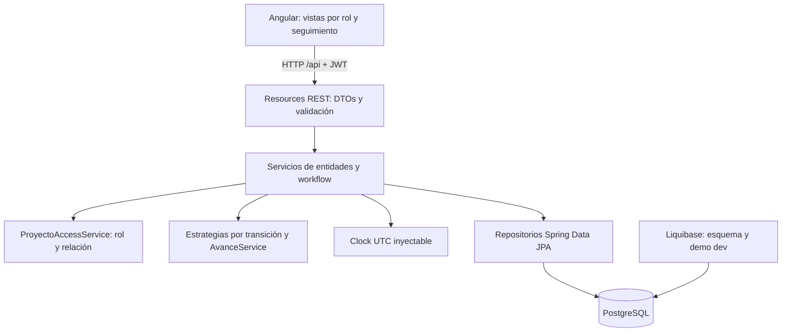

# SGPG — Seguimiento de proyectos de grado

SGPG demuestra un flujo académico completo: propuesta, revisión del tutor, evaluación de jurados, desarrollo, sustentación y cierre. Cada usuario ve los proyectos con los que tiene relación y cada transición exige evidencia verificable. El seguimiento reúne entregas, observaciones, evaluaciones, fechas límite e historial.

La especificación es [docs/PLAN.md](docs/PLAN.md), el modelo es [sgpg.jdl](sgpg.jdl) y las decisiones están en [docs/decisiones.md](docs/decisiones.md). Las tablas siguientes describen el contrato funcional que implementan los streams de backend y frontend.

## Stack y arquitectura

| Componente            | Versión/configuración del repositorio                         |
| --------------------- | ------------------------------------------------------------- |
| Generador             | JHipster 9.4.0, monolito                                      |
| Backend               | Java 21, Spring Boot 4.1.1, Maven Wrapper                     |
| Frontend              | Angular 22.1, TypeScript 6, Bootstrap 5                       |
| Persistencia          | PostgreSQL 18.6, Spring Data JPA, Liquibase                   |
| Seguridad             | Spring Security, JWT, roles y relación con el proyecto        |
| Pruebas               | JUnit 5, Mockito, Testcontainers PostgreSQL, Vitest           |
| Herramientas frontend | Node.js >= 24.21.0; dependencias fijadas en package-lock.json |

Aunque la introducción del plan menciona Java 17, `pom.xml` y su §7 requieren JDK 21.



Los servicios protegen las reglas; la interfaz presenta los requisitos. Los DTOs y mapeadores separan la API de las entidades. Las transiciones actualizan el proyecto y escriben su historial en una transacción.

## Etapas y avance

```mermaid
stateDiagram-v2
    [*] --> PROPUESTA: creación ACTIVO
    PROPUESTA --> ANTEPROYECTO: tutor + estudiantes + entrega aprobada + sin correcciones pendientes
    ANTEPROYECTO --> DESARROLLO: entrega aprobada + sin correcciones + al menos 2 jurados + todas las evaluaciones + aprobación
    DESARROLLO --> SUSTENTACION: documento final aprobado + sin correcciones + sustentación programada
    SUSTENTACION --> FINALIZADO: todos los jurados evaluaron; resultado según notas y conceptos
    FINALIZADO --> [*]
    note right of PROPUESTA
        Solo avanza un proyecto ACTIVO.
        Sin saltos ni retrocesos.
        Tutor del proyecto o coordinador.
    end note
    note right of FINALIZADO
        APROBADO: promedio >= 3.0
        y ningún concepto REPROBADO.
        En otro caso: REPROBADO.
    end note
```



El coordinador puede cancelar con comentario obligatorio: queda CANCELADO y se registra origen=destino=etapa actual. FINALIZADO es terminal para el avance.

Bases: PROPUESTA=0, ANTEPROYECTO=20, DESARROLLO=40, SUSTENTACION=75, FINALIZADO=100.

```text
avance = base + floor((baseSiguiente - base) * requisitosCumplidos / (totalRequisitos + 1))
```

Se recalcula tras entregas, revisiones, observaciones, evaluaciones y cambios de asignación. No se edita por PUT/PATCH. El `+1` del denominador reserva un tramo para completar la transición. P5 tiene 87% con todos los requisitos cumplidos y pendiente de cierre; solo FINALIZADO alcanza 100%, como P6.

## Matriz de permisos

Todos los usuarios demo tienen ROLE_USER además de su rol académico.

| Acción                                     | Coordinador (ROLE_ADMIN) | Estudiante                 | Tutor          | Jurado                       |
| ------------------------------------------ | ------------------------ | -------------------------- | -------------- | ---------------------------- |
| Ver proyecto y soportes                    | Todos                    | Los suyos                  | Donde es tutor | Donde es jurado              |
| Crear proyecto                             | Sí                       | Sí, queda vinculado        | No             | No                           |
| Editar título/resumen                      | Sí                       | Los suyos en PROPUESTA     | No             | No                           |
| Asignar estudiantes, tutor y jurados       | Sí                       | No                         | No             | No                           |
| Escribir etapa/estado/avance por PUT/PATCH | Nunca                    | Nunca                      | Nunca          | Nunca                        |
| Administrar fechas límite                  | Sí                       | Solo lectura               | Solo lectura   | Solo lectura                 |
| Crear entrega                              | No                       | Su proyecto y etapa actual | No             | No                           |
| Revisar entrega                            | Sí                       | No                         | Su proyecto    | No                           |
| Crear/resolver observación                 | Sí                       | Solo lectura               | Su proyecto    | Solo lectura                 |
| Crear evaluación                           | No                       | No                         | No             | Asignado, en etapa evaluable |
| Avanzar etapa                              | Sí                       | No                         | Su proyecto    | No                           |
| Cancelar                                   | Sí                       | No                         | No             | No                           |
| Consultar historial                        | Todos                    | Los suyos                  | Su proyecto    | Su proyecto                  |
| Escribir historial por REST                | Nunca                    | Nunca                      | Nunca          | Nunca                        |
| Borrar entidades editables                 | Sí                       | No                         | No             | No                           |

El historial es una excepción al borrado: solo lo escribe el workflow. Falta de permiso devuelve **403**; una regla de negocio incumplida devuelve **409**.

## Reglas y códigos estables

| Transición                | Códigos/requisitos que deben cumplirse                                                                                                                                    |
| ------------------------- | ------------------------------------------------------------------------------------------------------------------------------------------------------------------------- |
| PROPUESTA → ANTEPROYECTO  | `TUTOR_ASIGNADO`, `ESTUDIANTES_ASIGNADOS`, `ENTREGA_APROBADA`, `SIN_CORRECCIONES_PENDIENTES`                                                                              |
| ANTEPROYECTO → DESARROLLO | `ENTREGA_APROBADA`, `SIN_CORRECCIONES_PENDIENTES`, `JURADOS_ASIGNADOS` (mínimo 2), `EVALUACIONES_COMPLETAS`, `EVALUACION_APROBATORIA` (promedio >= 3.0, ningún REPROBADO) |
| DESARROLLO → SUSTENTACION | `ENTREGA_APROBADA`, `SIN_CORRECCIONES_PENDIENTES`, `SUSTENTACION_PROGRAMADA` (existe fecha para SUSTENTACION)                                                             |
| SUSTENTACION → FINALIZADO | `EVALUACIONES_COMPLETAS`; notas y conceptos determinan APROBADO/REPROBADO                                                                                                 |

| Operación                         | Regla / código 409                                                                                    |
| --------------------------------- | ----------------------------------------------------------------------------------------------------- |
| Crear entrega                     | Proyecto ACTIVO y no FINALIZADO: `PROYECTO_NO_ACTIVO`                                                 |
| Crear entrega                     | Si `ahora > fechaLimite` de la etapa: `FECHA_LIMITE_VENCIDA`; en el instante exacto todavía se admite |
| Crear entrega                     | Otra ENVIADA o EN_REVISION: `ENTREGA_EN_CURSO`                                                        |
| Crear entrega                     | Ya existe APROBADA en la etapa: `ETAPA_YA_APROBADA`                                                   |
| Aprobar entrega                   | Corrección requerida sin resolver en esa entrega: `CORRECCIONES_PENDIENTES`                           |
| Crear evaluación                  | Etapa distinta de ANTEPROYECTO o SUSTENTACION: `ETAPA_NO_EVALUABLE`                                   |
| Crear evaluación                  | Ya evaluó el mismo jurado en esa etapa: `EVALUACION_DUPLICADA`                                        |
| Crear evaluación                  | `calificacion < 3.0` si y solo si `concepto == REPROBADO`: `CONCEPTO_INCOHERENTE`                     |
| Asignar tutor/jurados/estudiantes | Cada usuario debe existir, estar activo y tener el rol correspondiente: `USUARIO_ROL_INVALIDO`        |

En la creación del proyecto, el servidor fuerza PROPUESTA, ACTIVO, avance 0 y fecha actual. Si crea un estudiante, lo vincula e ignora tutor/jurados enviados. PUT/PATCH ignoran o rechazan los campos de workflow y la fecha de registro.

En las entregas fuerza etapa actual, autor, fecha, versión siguiente y estado ENVIADA. El estudiante solo edita mientras está ENVIADA y no cambia versión, etapa ni estado. Solo se revisan entregas de la etapa actual. Una observación se crea sin resolver, con autor y fecha del servidor; si requiere corrección, la entrega pasa a CON_OBSERVACIONES. Las evaluaciones fuerzan jurado, etapa y fecha; solo el administrador puede editarlas.

Los conflictos se expresan como ProblemDetail con `status: 409`, `codigo` y `message: "error.reglaNegocio"`. Los códigos de requisitos explican qué falta para avanzar. La especificación no fija otros códigos: su implementación corresponde al stream de workflow/permisos.

## Contrato de API

| Método                    | Ruta                                          | Acceso / resultado                                                                                        |
| ------------------------- | --------------------------------------------- | --------------------------------------------------------------------------------------------------------- |
| POST                      | `/api/authenticate`                           | Credenciales → JWT                                                                                        |
| GET/POST/PUT/PATCH/DELETE | `/api/proyecto-grados[/{id}]`                 | CRUD según la matriz; sin cambiar workflow directamente                                                   |
| PUT                       | `/api/proyecto-grados/{id}/asignaciones`      | Solo admin; reemplaza asignaciones → `ProyectoGradoDTO`; 404 si no existe, 409 si un usuario no es válido |
| GET/POST/PUT/PATCH/DELETE | `/api/entregas[/{id}]`                        | Entregas según la matriz                                                                                  |
| GET/POST/PUT/PATCH/DELETE | `/api/observacions[/{id}]`                    | Observaciones según la matriz                                                                             |
| GET/POST/PUT/PATCH/DELETE | `/api/evaluacions[/{id}]`                     | Evaluaciones según la matriz                                                                              |
| GET/POST/PUT/PATCH/DELETE | `/api/fecha-limite-etapas[/{id}]`             | Lectura visible; escritura del administrador                                                              |
| GET                       | `/api/historial-etapas[/{id}]`                | Solo lectura visible; mutaciones prohibidas                                                               |
| GET                       | `/api/proyecto-grados/{id}/workflow`          | Quien puede ver → `RequisitosTransicionDTO`                                                               |
| POST                      | `/api/proyecto-grados/{id}/workflow/avanzar`  | Tutor del proyecto/admin → `ProyectoGradoDTO` o 409                                                       |
| POST                      | `/api/proyecto-grados/{id}/workflow/cancelar` | Admin → `ProyectoGradoDTO`                                                                                |
| GET                       | `/api/proyecto-grados/{id}/seguimiento`       | Quien puede ver → `SeguimientoProyectoDTO`                                                                |
| PUT                       | `/api/entregas/{id}/revision`                 | Tutor/admin; cuerpo `{ "estado": "EN_REVISION                                                             | CON_OBSERVACIONES | APROBADA | RECHAZADA" }`→`EntregaDTO` |
| PUT                       | `/api/observacions/{id}/resolver`             | Tutor/admin → `ObservacionDTO` resuelta                                                                   |
| GET                       | `/api/usuarios/por-rol/{authority}`           | Admin → `UsuarioResumenDTO[]`                                                                             |

`[/{id}]` resume colección e ítem; crear usa colección y editar/borrar el ítem. Se conservan los plurales generados `observacions` y `evaluacions`.

Asignaciones recibe `{ "tutorId": 2, "juradoIds": [3, 4], "estudianteIds": [1] }`. `tutorId: null` retira el tutor; ambas listas son obligatorias y `[]` elimina sus asignaciones. Los roles exigidos son `ROLE_TUTOR`, `ROLE_JURADO` y `ROLE_ESTUDIANTE`, respectivamente; un usuario inexistente, inactivo o sin ese rol produce 409 `USUARIO_ROL_INVALIDO`. Una lista omitida o nula produce 400. Se actualiza la fecha con el reloj del servidor y se recalcula el avance. El contrato del PATCH genérico se conserva.

Avanzar/cancelar reciben `{ "comentario": "texto" }` (opcional para avanzar, obligatorio para cancelar). Requisitos contiene `proyectoId`, `etapaActual`, `etapaSiguiente` (null al finalizar), `puedeAvanzar` y una lista `{codigo, descripcion, cumplido}`. Seguimiento incluye `proyecto`, `porcentajeAvance`, `etapas`, `historial` y `requisitos`. Cada etapa indica COMPLETADA/ACTUAL/PENDIENTE, fecha límite, vencimiento, días restantes, entregas y evaluaciones. El resumen de usuario contiene `id`, `login`, `firstName`, `lastName`.

## Usuarios y datos demo

Los once usuarios usan la contraseña **`user`**. Se reutiliza el hash BCrypt real del usuario base `user` de `config/liquibase/data/user.csv`; `DatosDemoTest` verifica la contraseña. Nombres y correos `@sgpg.example` son ficticios. Los enlaces de documentos también son ficticios y no alojan PDFs.

| Login         | Rol adicional   | Qué probar                                                              |
| ------------- | --------------- | ----------------------------------------------------------------------- |
| `coordinador` | ROLE_ADMIN      | Todos los proyectos, asignaciones, fechas y cancelación con comentario  |
| `estudiante1` | ROLE_ESTUDIANTE | P1 pendiente de revisión y P6 cerrado; no puede volver a entregar en P6 |
| `estudiante2` | ROLE_ESTUDIANTE | P2 aprobado; una nueva entrega en PROPUESTA se bloquea                  |
| `estudiante3` | ROLE_ESTUDIANTE | P3 con evaluación pendiente; no puede avanzar por sí mismo              |
| `estudiante4` | ROLE_ESTUDIANTE | P4 con corrección requerida y plazo vencido al intentar otra entrega    |
| `estudiante5` | ROLE_ESTUDIANTE | Seguimiento de P5 con evaluaciones completas                            |
| `tutor1`      | ROLE_TUTOR      | Revisa P1, avanza P2 y finaliza P5                                      |
| `tutor2`      | ROLE_TUTOR      | Bloqueo de P3, corrección de P4 e historial de P6                       |
| `jurado1`     | ROLE_JURADO     | P3, P5 y P6; ya evaluó sus etapas evaluables disponibles                |
| `jurado2`     | ROLE_JURADO     | P3, P4 y P6; falta su evaluación de ANTEPROYECTO en P3                  |
| `jurado3`     | ROLE_JURADO     | P4 y P5; ya evaluó el anteproyecto de P4 y ambas etapas de P5           |

| Caso / ID | Etapa / estado        | Avance (cumplidos/total requisitos) | Evidencia y resultado esperado                                                                                          |
| --------- | --------------------- | ----------------------------------- | ----------------------------------------------------------------------------------------------------------------------- |
| P1 / 2001 | PROPUESTA / ACTIVO    | 12% (3/4)                           | Entrega 3001 ENVIADA; falta `ENTREGA_APROBADA`                                                                          |
| P2 / 2002 | PROPUESTA / ACTIVO    | 16% (4/4)                           | Tutor, entrega 3002 APROBADA, sin observaciones; listo para avanzar                                                     |
| P3 / 2003 | ANTEPROYECTO / ACTIVO | 33% (4/5)                           | Entrega 3004 APROBADA, dos jurados, solo uno evaluó; falta `EVALUACIONES_COMPLETAS`                                     |
| P4 / 2004 | DESARROLLO / ACTIVO   | 48% (1/3)                           | Entrega 3007 CON_OBSERVACIONES, observación 4001 sin resolver; no avanza y otra entrega devuelve `FECHA_LIMITE_VENCIDA` |
| P5 / 2005 | SUSTENTACION / ACTIVO | 87% (1/1)                           | Fecha de sustentación y dos evaluaciones aprobatorias (4.20 y 4.50); listo para finalizar APROBADO                      |
| P6 / 2006 | FINALIZADO / APROBADO | 100%                                | Cuatro transiciones, entregas y evaluaciones históricas                                                                 |

Referencia temporal: **13 de noviembre de 2026**. Límites en 2027 salvo DESARROLLO de P4, vencido desde el 1 de noviembre de 2026 a las 23:59 UTC. Las fechas CSV expresan horas UTC sin sufijo, siguiendo el formato Liquibase; JPA usa UTC. P5 y P6 evaluaron antes de sus fechas límite: la regla exige una fecha existente, no esperar a ella. P1/P2 no tienen transiciones; P3–P6 tienen 1, 2, 3 y 4. `estudiante1` tiene P1 y P6 para cubrir seis proyectos con cinco estudiantes.

La carga usa contexto Liquibase `dev`, IDs de usuarios 1001–1011 y entidades 2001–7010. Las entidades y `jhi_user` comparten `sequence_generator` (inicio 1050, incremento/pool 50); se eleva al menos a `max(id)+50` sin reducirla. Los archivos faker se conservan y no se cargan en dev por defecto.

### Guion de demo de cinco minutos

1. **0:00–0:45, coordinador:** mostrar P1–P6, porcentajes y etapas; abrir el seguimiento de P6 y sus cuatro transiciones.
2. **0:45–1:30, estudiante1:** ver únicamente P1 y P6, la entrega ENVIADA de P1 y el proyecto cerrado. Contrastar la vista con coordinador.
3. **1:30–2:15, tutor1:** ver los requisitos pendientes de P1; avanzar P2 a ANTEPROYECTO y observar el historial.
4. **2:15–3:00, tutor2:** mostrar P3 bloqueado por `EVALUACIONES_COMPLETAS`. Con jurado2, registrar 4.0 / APROBADO; volver al tutor para ver que queda habilitado.
5. **3:00–4:00, estudiante4 y tutor2:** intentar otra entrega de P4 y ver `FECHA_LIMITE_VENCIDA`. Mostrar corrección 4001 y bloqueo de avance; aprobar esa entrega devuelve `CORRECCIONES_PENDIENTES`.
6. **4:00–5:00, tutor1:** finalizar P5, confirmar FINALIZADO/APROBADO e historial y comparar con P6. Con estudiante, comprobar que avanzar devuelve 403.

El guion modifica datos. Para repetirlo usa una base de desarrollo nueva y desechable: Liquibase carga una sola vez y reiniciar no deshace las transiciones. Si había faker, retirar el contexto no elimina sus filas; usa una base limpia para reproducir exactamente P1–P6.

## Ejecución local

Necesitas JDK 21, Node.js compatible y Docker activo para PostgreSQL. Si JDK 21 no es tu Java por defecto, apunta `JAVA_HOME` a él antes de usar Maven. En PowerShell:

```powershell
$env:JAVA_HOME="C:\ruta\a\jdk-21"
$env:PATH="$env:JAVA_HOME\bin;$env:PATH"
java -version
```

En Bash, ajusta la ruta a tu JDK:

```bash
export JAVA_HOME="/ruta/a/jdk-21"
export PATH="$JAVA_HOME/bin:$PATH"
```

Desde la raíz:

```bash
npm ci
docker compose -f src/main/docker/postgresql.yml up -d --wait
./mvnw -ntp -Dskip.npm -Dskip.installnodenpm
```

En PowerShell usa `./mvnw.cmd` y entrecomilla las propiedades Maven que contienen puntos: `./mvnw.cmd -ntp '-Dskip.npm' '-Dskip.installnodenpm'`. El perfil dev activa también `api-docs,secret-samples`; Liquibase aplica `dev`. Base: `jdbc:postgresql://localhost:5433/sgpg`, usuario `sgpg`, contraseña vacía en los perfiles de muestra. El compose permite conexiones locales de desarrollo con `trust` y publica solo `127.0.0.1:5433` (puerto 5433 en el host para no chocar con un PostgreSQL local instalado en 5432). No hay que importar CSV manualmente.

En otra terminal:

```bash
npm start
```

Abre `http://localhost:4200`; el proxy dirige `/api` al backend en `http://localhost:8080`. El backend sin reconstruir frontend sirve la API; para servir estáticos también en 8080 ejecuta antes `npm run webapp:build`. El PostgreSQL de desarrollo usa el puerto 5433 del host, así que puede convivir con un PostgreSQL local en 5432.

`src/main/docker/app.yml` espera la imagen local `sgpg` y arranca con perfil **prod**, sin datos demo. Esa alternativa requiere:

```bash
./mvnw -ntp verify -DskipTests -Pprod jib:dockerBuild
docker compose -f src/main/docker/app.yml up -d --wait
```

Ambos compose son de desarrollo y `secret-samples` contiene valores de muestra. Para la demo usa backend dev y el compose PostgreSQL descritos arriba.

## Pruebas y validación

Con JDK 21 configurado, compila y ejecuta unitarios sin Docker:

```bash
./mvnw -ntp -q test-compile -Dskip.npm -Dskip.installnodenpm
./mvnw -ntp test -Dskip.npm -Dskip.installnodenpm
./mvnw -ntp test -Dskip.npm -Dskip.installnodenpm -Dtest=DatosDemoTest
```

`DatosDemoTest` valida XML, encabezados CSV contra las tablas generadas, columnas obligatorias, relaciones y credenciales BCrypt. `DatosDemoIT` aplica el master Liquibase con contexto `dev` en un esquema temporal aislado, comprueba los escenarios, la secuencia y una segunda ejecución sin duplicados; después elimina el esquema.

Los `*IT` necesitan Docker activo para Testcontainers; no requieren levantar el compose manualmente:

```bash
./mvnw -ntp verify -Dskip.npm -Dskip.installnodenpm
./mvnw -ntp verify -Dskip.npm -Dskip.installnodenpm -Dtest=NONE -Dsurefire.failIfNoSpecifiedTests=false -Dit.test=DatosDemoIT -Dcheckstyle.skip -Djacoco.skip
```

Si el sandbox impide Docker, ejecuta compilación y unitarios y deja `DatosDemoIT` al coordinador. La validación estática no sustituye la carga real en PostgreSQL.

Para frontend y formato:

```bash
npm run lint
npm test -- --watch=false
npm run webapp:build
./mvnw -ntp -q spotless:apply -Dskip.npm -Dskip.installnodenpm
npx prettier --write README.md docs/decisiones.md src/main/resources/config/application-dev.yml
```

## Comandos JHipster útiles

```bash
npx jhipster jdl sgpg.jdl           # Regenerar modelo; revisar el diff y preservar reglas
./mvnw -ntp                       # Backend y construcción dev por defecto
./mvnw -ntp verify -Pprod          # Verificar y empaquetar producción
npm run java:docker               # Imagen local con Jib y Docker
```

Configuración: `.yo-rc.json`; entidades: `.jhipster/`; migraciones: `src/main/resources/config/liquibase/`.
